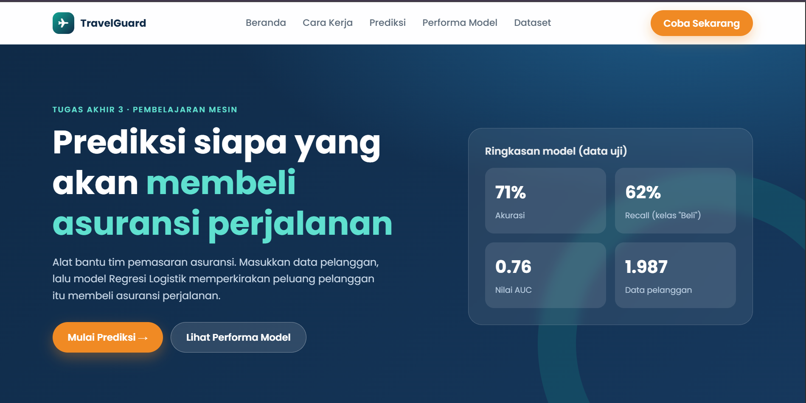
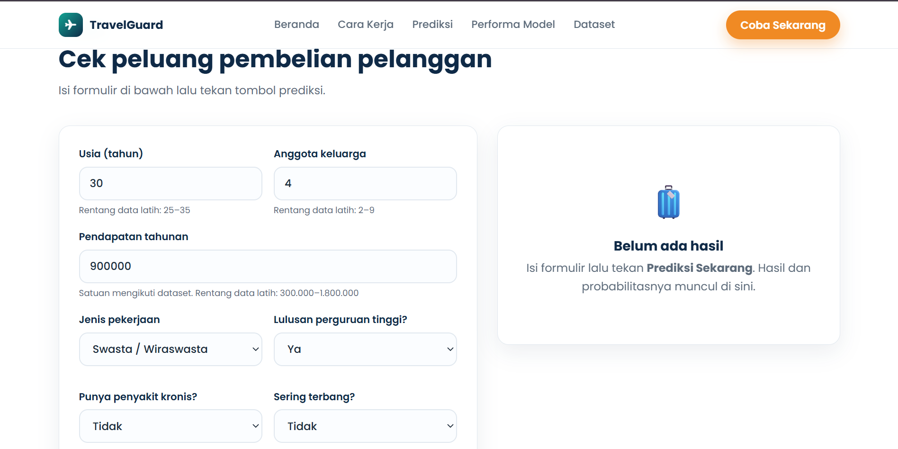
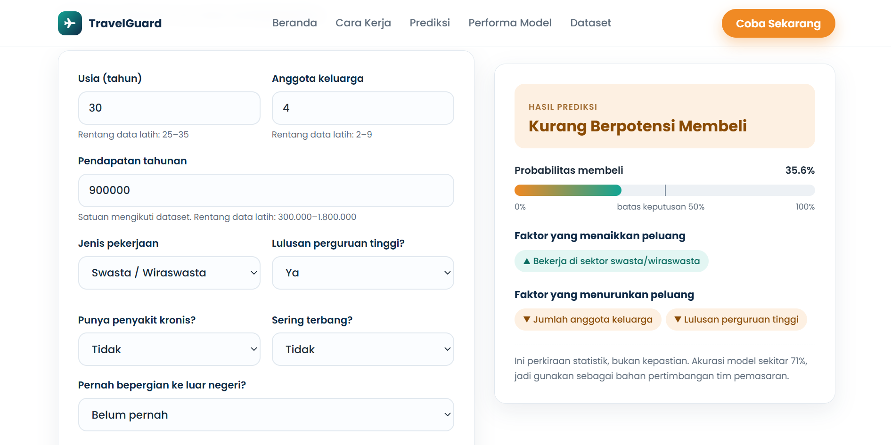
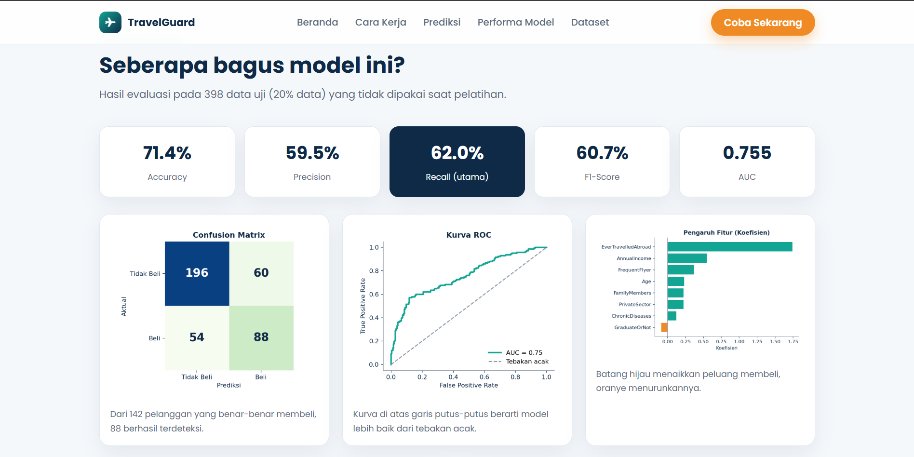

# TravelGuard - Prediksi Pembelian Asuransi Perjalanan


Aplikasi web berbasis Flask untuk memprediksi apakah seorang pelanggan akan **membeli asuransi perjalanan**, menggunakan algoritma **Regresi Logistik**. Hasil prediksi berupa label **Berpotensi Membeli** atau **Kurang Berpotensi Membeli** beserta probabilitasnya. Proyek ini adalah Tugas Akhir 3 (TA-03) mata kuliah Pembelajaran Mesin.

---

## Fitur Aplikasi

- **Prediksi Pelanggan** - isi data pelanggan pada formulir dan dapatkan hasil klasifikasi secara langsung
- **Probabilitas Pembelian** - ditampilkan dalam persen lengkap dengan batas keputusan 50%
- **Faktor Penentu** - menampilkan faktor yang paling menaikkan dan menurunkan peluang membeli
- **Validasi Input** - menolak input tidak valid dan memberi peringatan jika nilai di luar rentang data latih
- **Performa Model** - Accuracy, Precision, Recall, F1-Score, AUC, Confusion Matrix, dan kurva ROC
- **Informasi Dataset** - daftar fitur dan penjelasan singkat tiap kolom

---

## Teknologi

| Komponen | Teknologi |
|---|---|
| Backend | Flask 3.1, Gunicorn |
| Machine Learning | scikit-learn 1.7 (LogisticRegression, StandardScaler) |
| Data Processing | Pandas, NumPy |
| Visualisasi | Matplotlib, Seaborn (pelatihan dan notebook) |
| Penyimpanan Model | Joblib |
| Frontend | HTML, CSS (Jinja2) |
| Deployment | Gunicorn + Render |

---

## Dataset

- **Sumber:** [Kaggle - Travel Insurance Prediction Data](https://www.kaggle.com/datasets/tejashvi14/travel-insurance-prediction-data)
- **Jumlah data:** 1.987 baris
- **Fitur input (8):** Age, AnnualIncome, FamilyMembers, ChronicDiseases, Employment Type, GraduateOrNot, FrequentFlyer, EverTravelledAbroad
- **Target:** TravelInsurance (1 = membeli, 0 = tidak)
- **Proporsi kelas:** 35,7% membeli, 64,3% tidak membeli (cukup seimbang, SMOTE tidak dipakai)
- **Missing values:** 0
- **Baris duplikat:** 738 (37,1%), dipertahankan karena fitur data bersifat kasar

---

## Performa Model

Evaluasi pada 398 data uji (20% data, pembagian berstrata).

| Metrik | Nilai |
|---|---|
| Algoritma | Regresi Logistik (`class_weight="balanced"`) |
| Accuracy | 71,4% |
| Precision (kelas membeli) | 59,5% |
| **Recall (kelas membeli)** | **62,0%** |
| F1-Score | 60,7% |
| AUC | 0,755 (validasi silang 5 lipatan: 0,765) |
| Split Data | 80% Training / 20% Testing |
| Normalisasi | StandardScaler pada 3 fitur numerik |

Recall dijadikan metrik utama karena pelanggan yang sebenarnya mau membeli tetapi tidak terdeteksi (False Negative) lebih merugikan daripada pelanggan yang salah ditawari (False Positive).

> **Catatan:** jika baris duplikat dibuang, hasil menurun (Accuracy 62,4%, Recall 53,6%, AUC 0,645). Angka di atas kemungkinan batas atas kinerja pada pelanggan baru. Gunakan hasil prediksi sebagai perkiraan, bukan kepastian.

---

## Tampilan Aplikasi

> Ganti gambar placeholder di folder `docs/screenshots/` dengan tangkapan layar asli (nama file tetap sama).

### Beranda


### Formulir Prediksi


### Hasil Prediksi


### Performa Model


### Validasi dan Peringatan Input


---

## Instalasi Lokal

### 1. Clone repository

```bash
git clone https://github.com/<username>/<nama-repo>.git
cd <nama-repo>
```

### 2. Buat virtual environment

```bash
python -m venv venv

# Windows (PowerShell, jika muncul error execution policy:
# Set-ExecutionPolicy -Scope Process Bypass)
venv\Scripts\activate

# Linux / macOS
source venv/bin/activate
```

### 3. Install dependencies

```bash
pip install -r requirements.txt
```

### 4. Jalankan aplikasi

```bash
python app.py
```

Buka browser di `http://127.0.0.1:5000`

---

## Struktur Project

```
travelguard/
├── app.py                              # Entry point Flask
├── train_model.py                      # Script pelatihan model
├── analisis_travel_insurance.ipynb     # Notebook EDA dan evaluasi
├── Procfile                            # Konfigurasi Gunicorn untuk deployment
├── requirements.txt                    # Daftar dependensi Python
├── .gitignore
│
├── data/
│   └── TravelInsurancePrediction.csv   # Dataset 1.987 baris
│
├── model/
│   ├── model.joblib                    # Model Regresi Logistik tersimpan
│   ├── scaler.joblib                   # StandardScaler tersimpan
│   └── metrics.json                    # Metrik evaluasi dan koefisien
│
├── templates/
│   └── index.html                      # Halaman web (Jinja2)
│
├── static/
│   ├── style.css
│   └── img/                            # Grafik hasil pelatihan
│
└── docs/
    └── screenshots/                    # Tangkapan layar aplikasi
```

---

## Training Ulang Model

Jika ingin melatih ulang model:

```bash
python train_model.py
```

Script membersihkan dan mengubah data, membagi data 80:20, melatih model, lalu menyimpan `model.joblib`, `scaler.joblib`, `metrics.json`, dan grafik evaluasi. Jalankan ulang dengan versi library yang sama seperti di `requirements.txt` agar file model kompatibel.

---

## Cara Penggunaan

1. Buka halaman utama, lalu pergi ke bagian **Prediksi**
2. Isi data pelanggan:
   - Usia (rentang data latih 25-35 tahun)
   - Anggota keluarga (2-9 orang)
   - Pendapatan tahunan (300.000-1.800.000, satuan sesuai dataset)
   - Jenis pekerjaan, status lulusan, penyakit kronis, sering terbang, dan pernah ke luar negeri
3. Klik **Prediksi Sekarang**
4. Aplikasi menampilkan label prediksi, probabilitas pembelian, dan faktor yang memengaruhinya

---

## Deployment ke Render

1. Unggah proyek ke repositori GitHub
2. Di Render pilih **New > Web Service** lalu hubungkan repositori
3. Build command: `pip install -r requirements.txt`
4. Start command: `gunicorn app:app`
5. Setelah deploy selesai, aplikasi dapat diakses lewat URL yang diberikan Render
